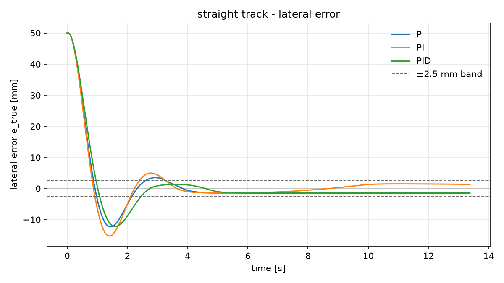
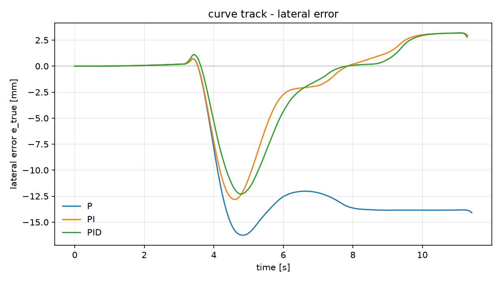
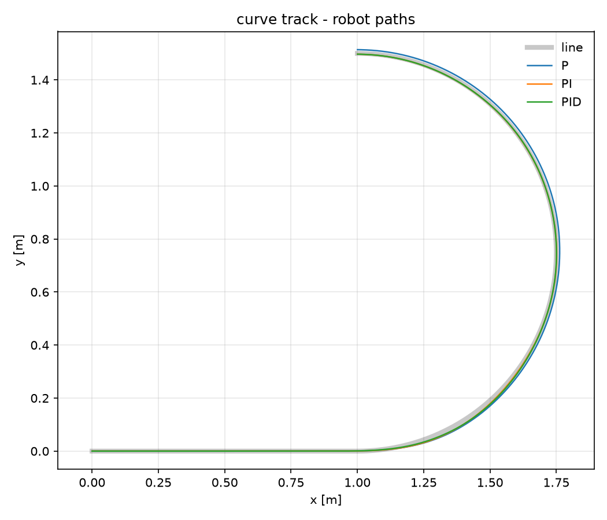
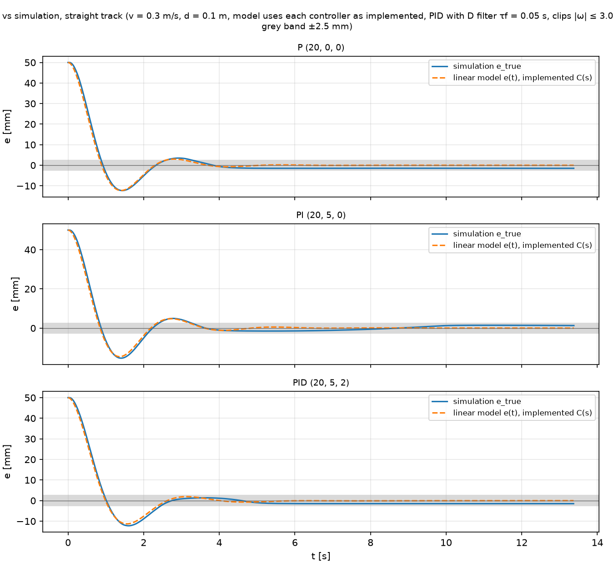
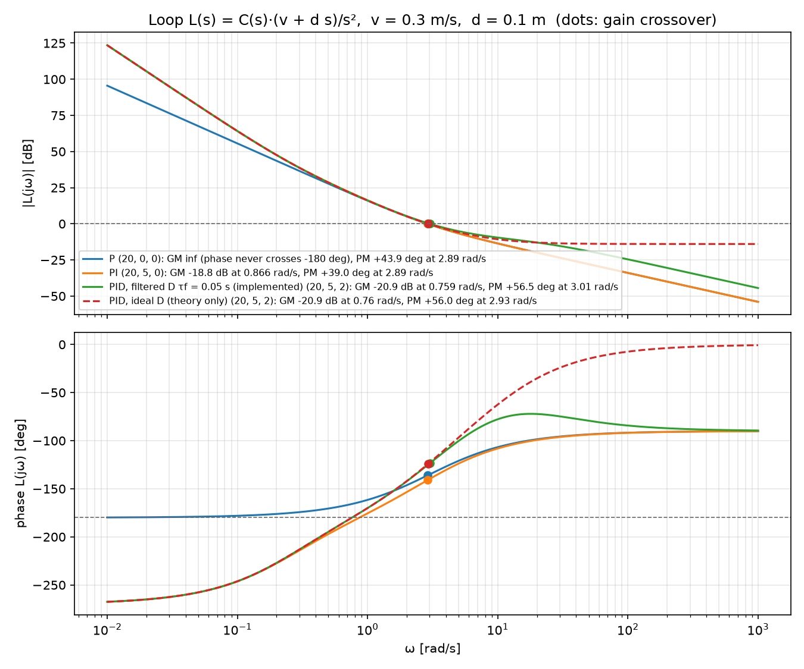

# Results

All numbers below come from the PyBullet simulation (`results/runs/*.csv`), generated by

```bash
python -m experiments.run_experiments --experiment all
python -m analysis.plot_results
python -m analysis.bode_analysis
```

with the frozen gains in `common/config.py`: P (20, 0, 0), PI (20, 5, 0), PID (20, 5, 2), derivative
filter τ = 0.05 s, v = 0.30 m/s, look-ahead d = 0.10 m, dt = 1/240 s. The simulation is
deterministic: rerunning the experiments reproduces every CSV byte for byte (checked 16 Nov 2026).
Synthetic data used only by the unit tests lives in `results/dummy/` (git-ignored, every figure
stamped "DUMMY DATA") and never feeds these tables.

Metric definitions are in [PROJECT_SPEC.md](PROJECT_SPEC.md). All metrics use the ground-truth
lateral error `e_true` from the robot pose, not the sensor reading.

## 1. Step response — straight track, 5 cm initial offset



| Controller | Rise time 90→10 % [s] | Overshoot [%] | Settling ±2.5 mm [s] | IAE [m·s] | Line lost |
|---|---|---|---|---|---|
| P   | 0.600 | 24.6 | 3.28 | 0.0540 | 0 % |
| PI  | 0.565 | 30.6 | 3.28 | 0.0540 | 0 % |
| PID | 0.668 | 24.4 | **2.46** | 0.0552 | 0 % |

What it shows:

- **P** is already stable and well damped, because the sensor bar sits ahead of the axle. Look-ahead
  adds a zero at −v/d to the loop, which is where the damping comes from (with d = 0 the same P
  loop would oscillate forever; see DESIGN.md §3).
- **PI** reacts slightly faster but overshoots more (30.6 %). On a straight line there is no
  constant disturbance for the integrator to remove, so the integral term only adds phase lag.
- **PID** settles fastest (2.46 s, 25 % faster than P). The D term damps the second swing: the
  first overshoot is about the same, but the response then enters the band without the extra
  oscillation. Its rise time is slightly longer because the D term opposes the fast initial swing.

## 2. Curve tracking — 1 m lead-in, then a left arc of R = 0.75 m through 180°




Metrics on arc rows only (`segment == "arc"`). The "Final-40 % mean" column is the metric named
`steady_state` in `results/summary_curve.md`: the **signed mean of e_true over the final 40 % of the
arc's duration**. It is a tail-window measurement, not a converged equilibrium (see below).

| Controller | Mean abs error [mm] | Max abs error [mm] | Final-40 % mean [mm] | IAE [m·s] | Line lost |
|---|---|---|---|---|---|
| P   | 12.7 | 16.3 | **−13.8** | 0.102  | 0 % |
| PI  | 3.7  | 12.8 | +2.2 | 0.0294 | 0 % |
| PID | 3.6  | 12.3 | +2.0 | 0.0288 | 0 % |

What it shows:

- On a curve the robot must keep turning at ω = v/R = 0.4 rad/s. A **P** controller only produces
  a turn command while there is an error, so it holds a steady offset on the outside of the turn.
  A hand calculation predicts it: u = 0.4 needs e_sensed = −0.4/Kp = −20 mm, and the sensor bar
  sees the curving line d²/(2R) = 6.7 mm further inside than the axle does, so
  e_true ≈ −20 + 6.7 = **−13.3 mm**. The simulation gives −13.8 mm.
- **PI and PID** reduce that offset from 13.8 mm to about 2 mm in the measured window, and cut
  the arc IAE by about 3.5×. The integrator gradually takes over supplying the 0.4 rad/s turn, so
  the controller no longer needs an error to produce it. This is the case the integral term
  exists for.
- What the integrator drives to zero is the **sensed** error, not the true one. Because the sensor
  sees the curving line d²/(2R) = 6.7 mm further inside, the true error of PI and PID converges
  towards **+6.7 mm** (inside the turn), not 0.
- That convergence is not finished when the arc ends. The integral pole is at about −0.25 s⁻¹
  (τ ≈ 4 s, DESIGN.md §3), comparable to the 7.9 s arc. Over the last 40 % of the arc the mean
  sensed error is still −4.0 mm (PI) and −4.1 mm (PID), and the true error is still rising
  through +2 mm (the curve in the figure). In a longer-arc check by the reviewer, PI's true error
  kept climbing (+6.0 mm at 14 s). So for PI and PID the final-40 % mean describes the end of
  this track, not a converged equilibrium. For P it is close to one: P's error is flat over that
  window (−13.8 mm, against the −13.3 mm hand calculation).

## 3. Linear model vs simulation



The linearised model in [MODEL.md](MODEL.md), E_s/Ω = (v + d s)/s², uses the same gains, the same
±3 rad/s clip and the controller as implemented (for PID, the filtered D with τf = 0.05 s). It
predicts the simulated step response closely:

| Controller | Rise time sim / model [s] | Overshoot sim / model [%] | Settling sim / model [s] |
|---|---|---|---|
| P   | 0.600 / 0.603 | 24.6 / 24.5 | 3.28 / 3.08 |
| PI  | 0.565 / 0.573 | 30.6 / 29.0 | 3.28 / 3.23 |
| PID | 0.668 / 0.676 | 24.4 / 22.6 | 2.46 / 2.38 |

The model ranks the controllers the same way on rise time and overshoot. It does not settle the
settling-time order of P and PI: the simulation gives both 3.28 s, while the model separates them
(3.08 vs 3.23 s). The remaining differences come from what the model leaves out: wheel dynamics,
the PyBullet contact model and, mostly, sensor quantisation (section 4), which shows up as the
1–1.5 mm residual the simulated curves sit at. The model's time response includes the D filter but not
the anti-windup logic. The steering command never comes near its ±3 rad/s limit in these runs
(max |u| ≈ 1.0 rad/s), so anti-windup never acts.

**Straight-track IAE does not rank the controllers.** About 0.015 m·s of each straight-track IAE
(≈27 %) is the ~1.5 mm dead-band residual held for the last ~10 s of the run. That is larger than the
≤2 % differences between controllers, and it is why the model's IAE (0.039–0.042) is lower than
the simulation's (0.054–0.055).

### Stability margins and Bode plot



From `results/model_margins.md` (d = 0.10 m):

| Controller | Closed-loop poles | ζ | Phase margin |
|---|---|---|---|
| P   | −1.00 ± 2.24j | 0.41 | 43.9° at 2.89 rad/s |
| PI  | −0.88 ± 2.30j, −0.25 | 0.36 | 39.0° at 2.89 rad/s |
| PID, filtered D τf = 0.05 s (implemented) | −0.99 ± 2.00j, −0.25, −23.8 | 0.44 | 56.5° at 3.01 rad/s |
| PID, ideal D (theory only) | −0.96 ± 2.00j, −0.25 | 0.43 | 56.0° at 2.93 rad/s |

The Bode plot draws every controller as implemented (solid lines). The ideal-D PID is a dashed,
labelled reference; the filter changes the PID margins only slightly.

The ordering of the damping ratios (PI < P < PID) is the same ordering the simulation shows in
overshoot. PI and PID report negative gain margins: they are conditionally stable (the phase
starts at −270° and rises through −180°), so the number says how far the gain could be *lowered*
before instability. The pole locations are the definitive check, and all of them are in the left
half-plane.

## 4. Known limitation — sensor resolution

Each sensor uses 10 sub-rays at a 3 mm pitch, and the line is 30 mm wide, exactly 10 pitches. When
the line moves sideways, one sub-ray leaves at one edge just as another enters at the other edge,
so the centroid moves in **3 mm steps**:

| True offset [mm] | 0 – 1.5 | 2.0 – 4.0 | 4.5 – 6.0 |
|---|---|---|---|
| Sensed offset [mm] | 0 | 3 | 6 |

So any true offset under about 1.5 mm reads as zero (a dead band), and the controllers cannot
see, or correct, an offset that small. This is why the simulated responses settle about 1.5 mm
off the line rather than at 0. The
settling band (±2.5 mm) is wider than the dead band, so every settling time above is still
meaningful. A finer sub-ray pitch would shrink the steps, but the sensor model is frozen in the
project spec.

## 5. Conclusions

1. All three controllers follow both tracks without losing the line.
2. On a step, **PID** settles fastest, with about the same overshoot as P; **PI** is the worst
   (most overshoot), because an integrator only adds lag where there is no steady disturbance.
3. On a curve, **P** keeps a steady offset of about 14 mm, matching the hand calculation. **PI**
   and **PID** reduce it to about 2 mm by the end of the arc. Their integrator zeroes the
   *sensed* error, so their true error converges slowly (τ ≈ 4 s) towards +6.7 mm, the sensor's
   look-ahead geometry offset, and has not finished converging on this 7.9 s arc.
4. A linear model with two plant states (lateral error and heading) plus sensor look-ahead
   predicts the simulated step metrics closely: rise time within 0.01 s, overshoot within about 1.8
   percentage points (PID: 24.4 % vs 22.6 %), settling time within 0.21 s. Its pole and margin analysis explains the
   rise-time and overshoot ranking.
